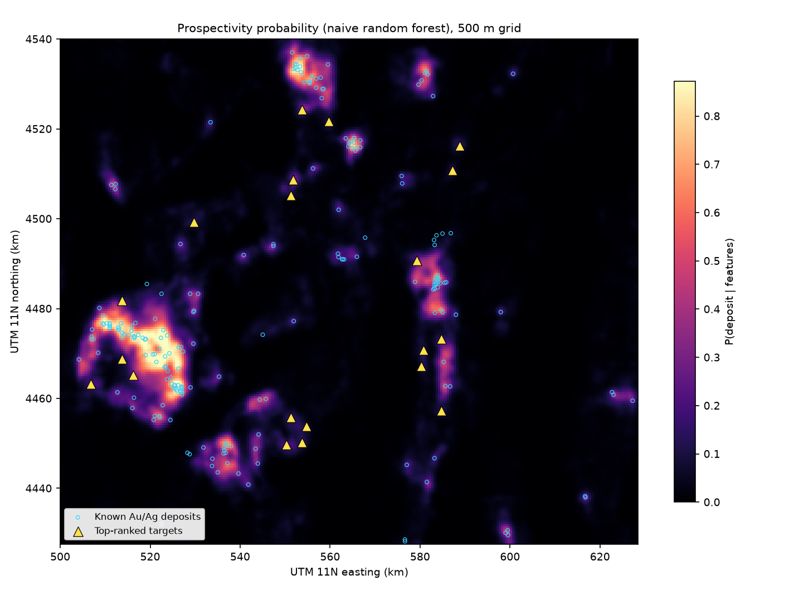

# Prospectivity Mapper

Machine-learning mineral prospectivity mapping for the Carlin trend and Battle
Mountain area of Nevada, built entirely from **free**, publicly available geological datasets. No authentication is required for data acquisition; a free CARTO API
key is required only for the interactive map basemap. Known Au–Ag deposits are the positive class; the rest of the map is unlabelled ground. A random forest ranks every 500 m cell, SHAP explains why, and the result is delivered as GeoTIFFs, a ranked target list, figures and an interactive map.



**Headline result** (spatial hold-out: 61 deposits the model never saw)

| model | ROC AUC | average precision | deposits captured in top 10% of area |
|---|---|---|---|
| random forest, P vs background | **0.873** [0.823–0.913] | **0.300** | **64%** (6.4× lift) |
| PU learning (soft negatives) | 0.863 [0.816–0.904] | 0.216 | 61% (6.1× lift) |

The median held-out deposit falls in the top 6.5% of ranked cells, and 16% of
held-out deposits are in the top 1% of the area. Full discussion, including
what did **not** work, is in [REPORT.md](REPORT.md).

## Quick start

```bash
make install          # create .venv and install dependencies
make fetch            # download ~730 MB of free public data
export CARTO_API_KEY="your_api_key_here"          # Configure your CARTO API key (see CARTO API Key Setup)
make run              # full pipeline, ~2 minutes
make test             # 18 unit tests
```

Or manually:

```bash
python3 -m venv .venv
.venv/bin/pip install -r requirements.txt
PYTHONPATH=src .venv/bin/python -m prospectivity run
```

Then open `output/prospectivity_map.html`.

## CARTO API Key Setup

The interactive prospectivity map uses CARTO Dark Matter tiles for its dark-themed basemap.

A free CARTO API key is required to display the basemap.

1. Visit [CARTO Basemaps API Key](https://www.carto.com/basemaps/apikey/).
2. Obtain your free API key.
3. Set the environment variable in your terminal:

```bash
export CARTO_API_KEY="your_api_key_here"
```

4. Run the project:

```bash
make run
```

**Important:**
- Each user must obtain and configure their own CARTO API key.
- Never commit your API key to GitHub.
- The API key is only required for the interactive map's CARTO basemap, not for downloading or processing the geological datasets.

## What it does

```
free data ──► align to one 500 m UTM grid ──► 41 features ──► RF / PU model
                                                                  │
        figures, GeoTIFFs, target list, Folium map ◄── SHAP ◄─────┘
```

1. **Acquire** — Copernicus GLO-30 DEM, USGS Nevada geologic map (+ faults),
   USGS magnetic and Bouguer gravity grids, USGS NGDB stream sediments, USGS
   MRDS deposits. All cached under `data/raw`.
2. **Align** — everything is resampled/rasterised/interpolated onto a single
   257 × 225 lattice at 500 m (EPSG:32611).
3. **Engineer** — terrain derivatives, lithology one-hots and 3 km proportions,
   fault/contact/intrusion distances, magnetic and gravity gradients, vertical
   derivatives, analytic signal, and a composite geochemical anomaly score.
4. **Label** — 216 cells contain a known Au/Ag deposit; cells within 2 km of a
   deposit are withheld from both classes; 52,968 cells are unlabelled.
5. **Model** — random forest trained on positives vs background, plus a
   positive-unlabelled learner for comparison; validated on spatially disjoint
   blocks, never on neighbouring cells.
6. **Explain** — TreeSHAP global importance, dependence plots, and a local
   waterfall for the top-ranked target.
7. **Deliver** — probability GeoTIFF (raw and smoothed), 20 non-maximum
   suppressed targets, 8 figures, an interactive HTML map, and a model bundle.

## Outputs

| file | contents |
|---|---|
| `output/prospectivity_probability.tif` | per-cell probability, float32 |
| `output/prospectivity_probability_smoothed.tif` | 500 m Gaussian-smoothed surface (used for ranking) |
| `output/top_targets.csv` | 20 ranked targets with lon/lat, probability and distance to the nearest known deposit |
| `output/shap_importance.csv` | mean absolute SHAP value per feature |
| `output/shap_values.npz` | full SHAP matrix + feature values + cell coordinates |
| `output/metrics.json` | metrics, feature list, split sizes, selected model |
| `output/figures/` | study area, feature layers, map, performance, SHAP, target explanation |
| `output/models/prospectivity_model.joblib` | fitted models + prior + grid geometry |
| `output/prospectivity_map.html` | Interactive Folium map (generated locally; requires CARTO API key for the basemap) |

**Note:** The interactive HTML map is excluded from the Git repository
because it contains the configured CARTO API key. Generate it locally
by following the CARTO API Key Setup instructions.

## Repository layout

```
configs/study_area.yaml      every run parameter, AOI, sources, model, targeting
src/prospectivity/
  config.py                  typed YAML loader
  grid.py                    the analysis lattice
  sources.py                 download, parse and normalise the free datasets
  terrain.py                 DEM derivatives
  geology.py                 lithology, contacts, faults
  geophysics.py              magnetics, gravity, FFT vertical derivative
  geochemistry.py            IDW interpolation, anomaly score
  features.py               feature cube assembly and sampling
  labels.py                  positives, buffer, unlabelled pool
  model.py                   random forest + PU learning
  evaluate.py                AUC, AP, capture curves, bootstrap CI
  explain.py                 SHAP
  viz.py                     figures + Folium map
  pipeline.py                orchestration
  cli.py                     `python -m prospectivity {fetch,labels,info,run}`
scripts/experiment_features.py   feature-set ablation used in the report
tests/                       fast unit tests, no downloads required
```

## Configuration

Everything is driven by `configs/study_area.yaml`: AOI, CRS, resolution,
commodity filter, buffer, negative sampling, model hyper-parameters, and
targeting rules. To map another district, change `aoi_wgs84`, the state geology
URL, and the commodity list. No code changes required.

## Data

All layers are public domain / open government data, no API keys:

| layer | source | resolution |
|---|---|---|
| DEM | Copernicus DEM GLO-30 (AWS Open Data `copernicus-dem-30m`) | 30 m |
| geology + faults | USGS state geologic map compilation (SGMC), Nevada | 1:500k |
| magnetic anomaly | USGS residual total intensity, conterminous US | 1 km |
| Bouguer gravity | USGS complete Bouguer anomaly, conterminous US | 2 arc-min |
| geochemistry | USGS National Geochemical Database, stream sediments (NURE) | point samples |
| deposits | USGS Mineral Resources Data System (MRDS) | point records |

## Caveats

This is a **demonstration of method**, not an exploration recommendation. The
unlabelled cells are not proven barren, MRDS coordinates vary in precision,
geochemistry is sparse, and the model is calibrated to one 1.5° × 1° window.
`REPORT.md` §13 lists the limitations in detail.

## License

Code: MIT. Data: as published by the respective USGS / Copernicus programmes.
