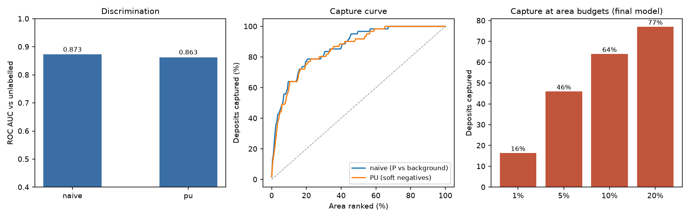
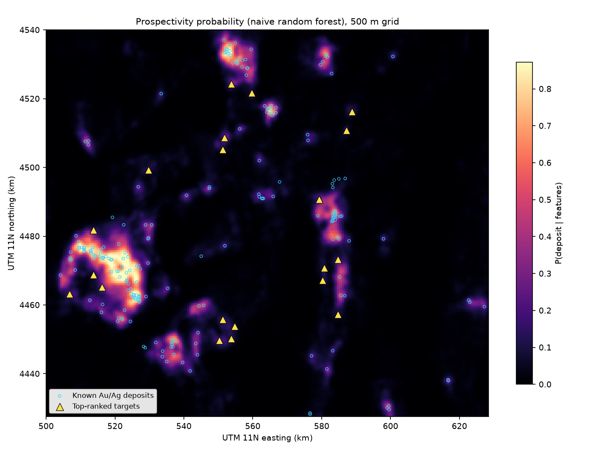
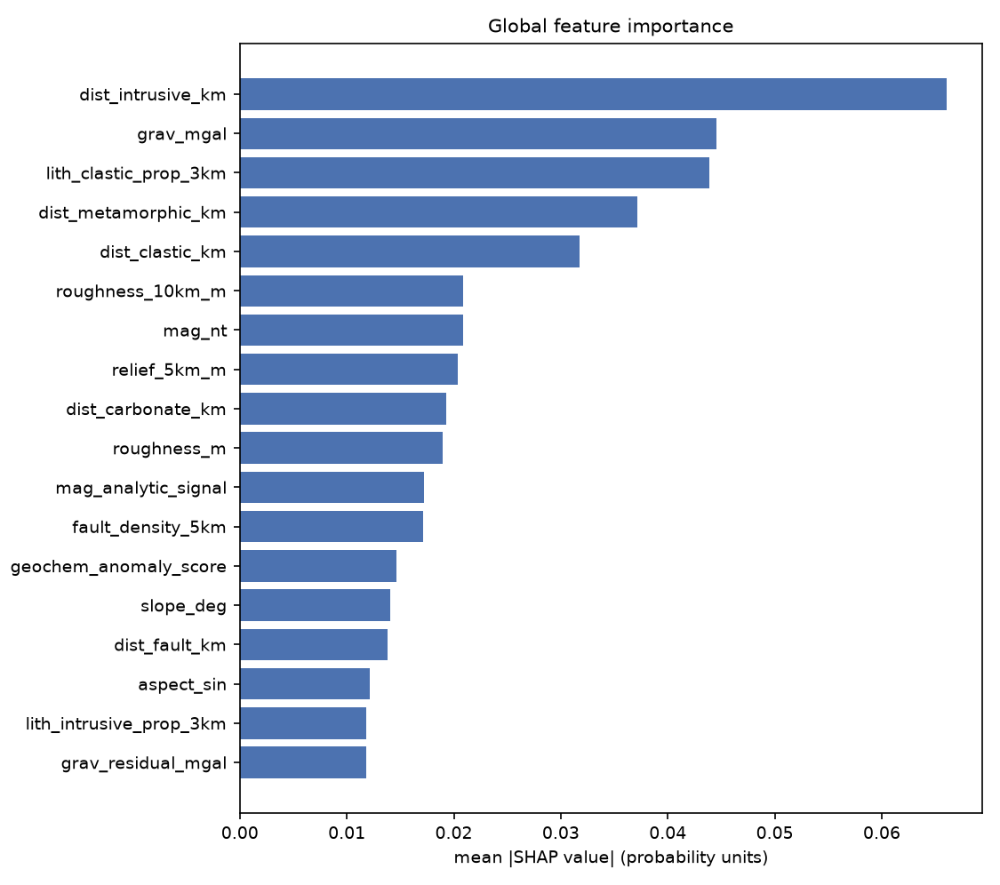
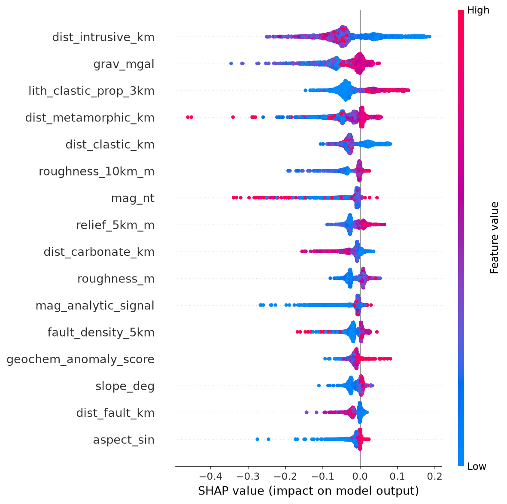
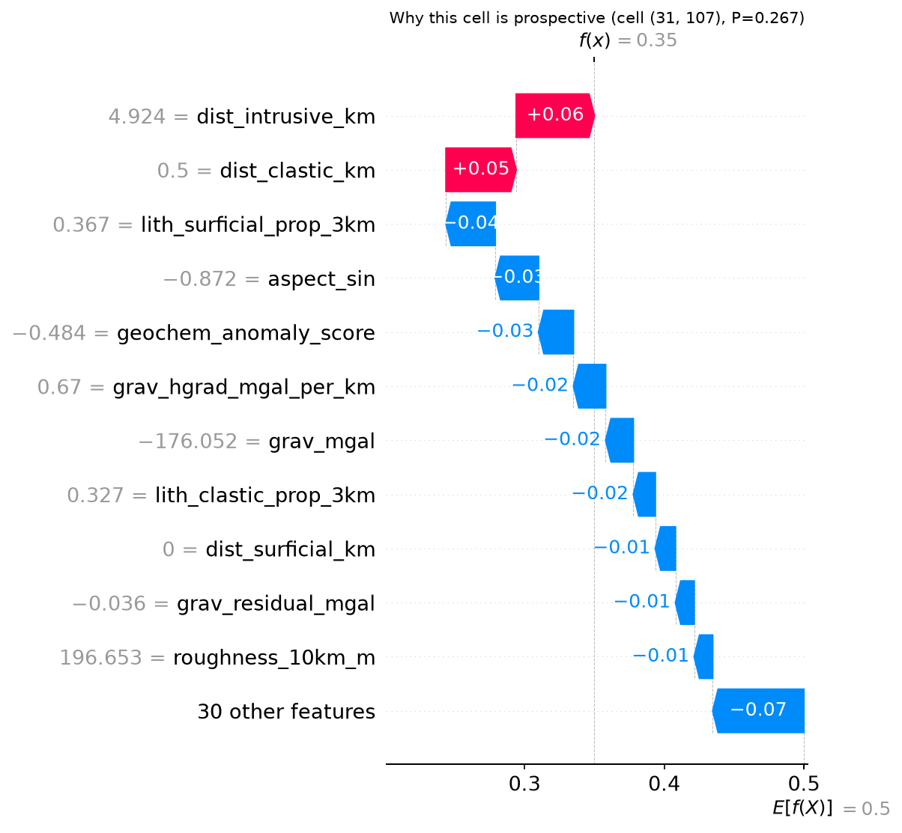

# Prospectivity Mapper — Project Report

**Project:** ML-based mineral prospectivity mapping with known deposits
**Study area:** Carlin trend and Battle Mountain, north-central Nevada, USA
**Grid:** 257 × 225 cells at 500 m (57,825 cells, 14,456 km²), EPSG:32611
**Target:** Au–Ag mineralisation
**Stack:** Python 3.14, scikit-learn, rasterio, geopandas, SHAP, Folium, Matplotlib
**Data:** 100% free, no account, no API key, no paid service
**Runtime:** ~2 minutes end-to-end after a ~730 MB one-time download

---

## 1. Executive summary

This project builds a mineral prospectivity map from scratch. It takes public
geoscience layers, aligns them onto one raster lattice, derives 41 exploration
features, labels cells containing known gold/silver deposits as positives,
treats everything else as unlabelled, and trains a classifier that scores every
cell in the study area.

The model was asked to rank 61 deposits it had **never seen**, held out in
spatially disjoint 8 km blocks:

* **ROC AUC 0.873** (95% bootstrap CI 0.823–0.913) against background.
* **64% of held-out deposits fall inside the top 10% of the area** — a 6.4×
  lift over random selection.
* **16% fall inside the top 1%** — a 16.4× lift.
* The **median** held-out deposit sits in the **top 6.5%** of ranked cells.

A positive-unlabelled (PU) learner was also implemented and evaluated. It
scored AUC 0.863 and captured 61% at 10%, statistically indistinguishable from
the simpler model, and was **not** selected. That negative result is reported
in full (§12) because it is part of the honest answer.

SHAP says the map is driven by **proximity to mapped intrusive rocks**, the
**gravity field**, **clastic host-rock abundance**, **metamorphic and clastic
contact distances**, and terrain roughness — a sensible Carlin-system
signature. The interactive map, GeoTIFFs, ranked targets, and all figures are
in `output/`.

---

## 2. What the problem actually is

A prospectivity map answers: *given what we can measure at the surface, where
is an ore deposit most likely to exist?*

Two things make this harder than ordinary classification:

1. **There are no confirmed negatives.** We know where deposits are; we do not
   know that anywhere else is barren. Absence of a mine may mean absence of ore,
   or absence of exploration, or merely poor exposure. Treating "not a known
   deposit" as "negative" is a modelling convenience with a known bias.
2. **Positives are extremely rare and spatially clustered.** 216 positive cells
   out of 52,968 available cells is 0.4%. Random cross-validation is invalid
   here: neighbouring 500 m cells share almost identical features, so a random
   split leaks the answer into the test set and inflates scores.

The project therefore uses (a) a **spatial block hold-out**, and (b) an
explicit **positive-unlabelled** formulation alongside the conventional
background-as-negative baseline.

---

## 3. Study area and analysis grid

The AOI is `[-117.0, 40.0, -115.5, 41.0]` (WGS84), covering the Carlin trend,
Battle Mountain, and the surrounding Basin-and-Range terrain. It contains the
Carlin mine itself, plus hundreds of satellites, placers, and prospects.

Everything is expressed on a single north-up lattice:

```
crs        EPSG:32611 (WGS84 / UTM 11N)
cell       500 m × 500 m  (0.25 km²)
size       257 columns × 225 rows = 57,825 cells = 14,456 km²
transform  origin (500000, 4540000), pixel 500 m
```

The AOI corners are transformed to UTM, the envelope is expanded to whole
cells, and all layers are resampled to this grid. This is the single most
important design decision in the project: because raster, vector and point data
share one lattice, the feature cube is a simple array stack and a "sample" is
just the vector of values at a row/column.

---

## 4. Data: sources, provenance and preprocessing

All six datasets are free and require no authentication. They are cached under
`data/raw/`, normalised once into `data/processed/`, and never re-downloaded.

| layer | source | native form | native resolution | local file |
|---|---|---|---|---|
| DEM | Copernicus DEM GLO-30, AWS Open Data bucket `copernicus-dem-30m` | 1° GeoTIFF COGs | 30 m | 2 tiles, 74 MB |
| geology | USGS state geologic map compilation (SGMC), Nevada | shapefile + unit/lithology tables | 1:500,000 | 66 MB zip |
| structure | USGS Nevada structure layer | shapefile | 1:500,000 | included above |
| magnetic | USGS residual total-intensity anomaly, conterminous US | ESRI binary grid | 1 km | 47 MB zip |
| gravity | USGS complete Bouguer anomaly, conterminous US | XYZ text grid | 2 arc-min | 6 MB gz |
| geochemistry | USGS National Geochemical Database, stream sediments (NURE) | long-format CSV | point samples | 158 MB zip |
| deposits | USGS Mineral Resources Data System (MRDS) | CSV | point records | 25 MB zip |

### 4.1 DEM

Two Copernicus tiles (`N40_00_W117_00`, `N40_00_W116_00`) are downloaded,
mosaicked, cropped to the AOI plus a 0.01° margin, and warped bilinearly to the
500 m grid. The result is a clean elevation surface from ~1,290 m valley floors
to ~3,210 m ranges.

### 4.2 Geology

The Nevada geologic map stores only a unit key in the polygons. The actual
lithology lives in two lookup tables: `NV_units.csv` (unit → name, age,
rock type) and `NV_lith.csv` (unit → hierarchical lithology: `lith1`, `lith2`,
`lith3` with a Major/Incidental rank). Units are joined on `unit_link`, the
dominant ("Major") lithology row is preferred, and the text is mapped onto ten
classes:

```
0 unknown            1 intrusive_felsic    2 intrusive_mafic
3 volcanic_felsic    4 volcanic_mafic      5 sedimentary_carbonate
6 sedimentary_clastic 7 sedimentary_chemical 8 metamorphic
9 surficial (alluvium, playa, glacial, eolian)
```

**A real data problem and its fix.** The unit table only names 102 of the 169
unit keys used by the polygons. Joining alone left 54% of the AOI with no
lithology. The polygons also carry a `GENERALIZE` field ("Sedimentary,
carbonate", "Igneous, intrusive", ...). Using it as a coarse fallback raised
lithology coverage from **45.9% to 100%** while keeping the more precise
unit-level class wherever one existed. This is documented in code and is the
kind of join that silently ruins a feature layer if you do not check it.

Faults come from `NV_structure.shp`, filtered to `DESCRIPT` containing "fault"
(2,714 features in the AOI) and rasterised with `all_touched=True` so thin
lines survive the 500 m grid.

### 4.3 Magnetics

The USGS grid is an ESRI binary grid in a custom Transverse Mercator with a
spherical earth radius (6,371,204 m). GDAL reads it; reprojection to WGS84/UTM
is therefore approximate at the few-hundred-metre level. At a 500 m cell that
is acceptable for regional gradients but is listed as a caveat (§13). Values in
the AOI range from −304 to +499 nT.

### 4.4 Gravity

The downloadable "GeoTIFF" at the obvious URL is actually a rendered RGB image,
and the `.grd` is a Geosoft binary that GDAL cannot read. The usable product is
the **XYZ text grid** (`bouguer.xyz.gz`, 2 arc-min, NAD27 geographic). It is
read with `np.loadtxt`, projected, and interpolated onto the grid with
inverse-distance weighting (k = 6). Values span −225 to −162 mGal.

### 4.5 Geochemistry

The NGDB sediment database ships as a 665 MB long-format table (one row per
lab/species/value). The loader streams `main.csv` (sample locations), keeps the
272 samples inside the AOI, then streams `bestvalue.csv` in 500k-row chunks and
keeps only those sample IDs. Result: **61 samples** with the configured
elements. Negative values are NGDB's "below detection limit" convention and are
replaced by half the reported detection limit; percent units are converted to
ppm.

Coverage is genuinely sparse — roughly one multi-element sample per 200 km².
Interpolation is inverse-distance weighting (k = 10, 40 km cut-off) followed by
a 1-cell Gaussian blur. The report treats these as the weakest layers, and the
ablation in §12 shows the model is better off without the individual element
grids.

### 4.6 Deposits

MRDS records are filtered to the AOI (734 records), then to Au/Ag commodities
and non-plant statuses (342 records). Because MRDS coordinates are often rounded
to 2 decimal places, many records collapse onto the same 500 m cell: **342
records → 216 unique positive cells**. Confidence is coded from `dev_stat`
(Producer/Past Producer = 3, Prospect = 2, Occurrence/Unknown = 1, Plant/Mill =
0 and excluded).

---

## 5. Feature engineering (41 features)

Every feature is computed on the common grid. No feature uses deposit locations.

### Terrain (9)
From the 500 m DEM: elevation, slope, aspect sine/cosine, Laplacian curvature
(per km), 3×3 roughness (2σ), TPI (elevation minus 3×3 mean), 5 km relief
(max−min in an 11×11 window), and 10 km roughness.

### Geology and structure (22)
* Nine binary lithology indicators (dominant class in the cell).
* Six neighbourhood proportions: the fraction of each rock group within a
  3.5 km (7×7) window — "does this cell sit inside a belt of carbonate?"
  matters more than the exact cell's class.
* Distance to the nearest lithological contact (km).
* Distance to the nearest fault (km) and fault line density (km/km²) in a
  5.5 km window.
* Distance to the nearest intrusive, carbonate, volcanic, clastic,
  metamorphic and surficial exposure (km).

The contact-distance features were added after an ablation showed a large gain
(§12). They express "how far is this cell from the nearest granite" directly,
which a tree otherwise has to reconstruct from one-hot cells and neighbourhood
fractions.

### Geophysics (9)
Magnetics: field value, horizontal gradient magnitude (nT/km), first vertical
derivative, 2-D analytic signal, and a short-wavelength residual.

The vertical derivative is computed in the Fourier domain: for a potential
field measured on a plane, `∂T/∂z ⇔ |k| · F(k)`. A cosine taper above 60% of
the Nyquist wavenumber suppresses grid noise amplification — without it, the
derivative is dominated by pixel-scale artefacts.

Gravity: Bouguer value, horizontal gradient (mGal/km), short-wavelength
residual.

Structural complexity: `hypot(z(mag_hgrad), z(grav_hgrad))`, a proxy for the
density of buried contacts and fault intersections.

### Geochemistry (1)
Eight element grids (As, Sb, Cu, Pb, Zn, Ag, Fe, Mn) are computed and kept as
layers, but only a **composite anomaly score** — the mean z-score of the six
pathfinder elements (As, Sb, Ag, Cu, Pb, Zn) — enters the model. With 61
samples, eight independent surfaces are not defensible; the composite is. The
ablation in §12 quantifies why.

---

## 6. Labels and the positive-unlabelled framing

```
216  positive cells      (a known Au/Ag deposit falls in the cell)
4,857 withheld cells     (within 2 km of a known deposit — neither class)
52,968 unlabelled cells  (everything else)
```

The 2 km buffer matters. The immediate surroundings of a mine are almost always
mineralised; sampling them as negatives would teach the model to call ore
ground barren. Withholding them costs 8.4% of the grid and removes the most
misleading labels.

The buffer also creates a subtle effect: cells just outside it can score highly
because they resemble the deposit cells. That is why **target reporting uses a
5 km minimum distance** from known deposits — otherwise the "targets" would
simply be step-outs around existing mines, not undrilled ground.

### Spatial split

Cells are assigned to 8 km blocks; whole blocks are held out. The split is by
block, not by random cell, so the test deposits are in districts the model has
not seen:

```
train: 155 positives / 20,000 unlabelled
test :  61 positives /  2,405 unlabelled
```

The unlabelled training pool is capped at 20,000 cells. Cells are spatially
autocorrelated, so a 20k random subsample is statistically ample and keeps the
PU bagging loop fast.

---

## 7. Models

### 7.1 Baseline: random forest, positives vs background

`RandomForestClassifier(n_estimators=500, min_samples_leaf=10,
max_features=0.33, class_weight="balanced_subsample")`.

Regularisation was tuned on the spatial hold-out. With `min_samples_leaf=3` and
`max_features="sqrt"` the forest memorised individual positive cells and
produced tight halos around known mines; `min_samples_leaf=10` with one third
of the features per split scored better *and* produced a smoother regional
surface.

"Background" here means the 20,000 sampled unlabelled cells, treated as
negative. This is the standard presence/background approach in mineral
prospectivity and is the model that ships.

### 7.2 PU learning

Implemented as a bagged, soft-negative Elkan–Noto variant:

1. Train 5 classifiers on positives vs 80% bootstrap samples of the unlabelled
   pool.
2. Average their scores to estimate `P(s=1|x)` for every unlabelled cell.
3. Train a final classifier on positives vs **all** unlabelled cells, weighting
   each unlabelled cell by `1 − score`: likely-mineralised cells count for
   little, likely-barren cells count fully.
4. Prior-correct the output: divide by `c = mean p` on the known positives
   (c = 0.802 here) to recover a probability scale.

A hard variant (keep only the lowest-scoring 15% of unlabelled cells as
"reliable negatives", classic Elkan–Noto) is also implemented. Both were
evaluated; neither beat the baseline.

### 7.3 Model selection

`configs/study_area.yaml` sets `selection: "naive"`, reflecting the development
comparison. The pipeline always trains and reports both models, so the
comparison is reproducible. An `auto` setting is available but selects on the
same hold-out used for reporting, which is methodologically weaker; the default
does not use it.

---

## 8. Evaluation protocol

The metrics deliberately do **not** pretend the unlabelled cells are true
negatives. They measure ranking against background:

* **ROC AUC** — probability a held-out deposit outranks a random background
  cell. Because some background cells are undiscovered deposits, this is a
  lower bound on true discrimination.
* **Average precision (AP)** — area under the precision–recall curve; more
  sensitive than AUC to the top of the ranking, which is what exploration
  cares about.
* **Capture at k%** — fraction of held-out deposits inside the top k% of ranked
  cells; **lift** = capture / k.
* **Median positive percentile** — where the typical held-out deposit sits.

The 95% CI is a bootstrap over positives and background cells (300 resamples).

---

## 9. Results

### 9.1 Headline

| metric | naive RF (selected) | PU (soft negatives) |
|---|---|---|
| ROC AUC | **0.873** [0.823–0.913] | 0.863 [0.816–0.904] |
| average precision | **0.300** | 0.216 |
| capture @ 1% of area | **16.4%** (lift 16.4×) | 14.8% (14.8×) |
| capture @ 5% | **45.9%** (9.2×) | 44.3% (8.9×) |
| capture @ 10% | **63.9%** (6.4×) | 60.7% (6.1×) |
| capture @ 20% | **77.0%** (3.9×) | 75.4% (3.8×) |
| median positive percentile | **6.5%** | 7.7% |

The confidence intervals overlap almost completely: the two models are not
statistically distinguishable on AUC. The baseline is ahead on AP and on every
capture budget, so it is the model used for the map.



### 9.2 Spatial behaviour



The high-probability belts follow the known district structure: the
Carlin–Carlin North corridor in the north-west, the Battle Mountain trend, and
the southern cluster near 40.3°N. The background is intentionally low —
with a 0.4% positive rate and balanced class weights, most of the basin
correctly scores near zero.

The map is the **smoothed** surface (σ = 1 cell) used for target ranking; the
unsmoothed per-cell probabilities are also written as a GeoTIFF.

### 9.3 Top targets

20 targets are extracted by greedy non-maximum suppression on the smoothed
surface, with ≥3 km between targets and ≥5 km from any known deposit:

| rank | longitude | latitude | probability | km to nearest known deposit |
|---|---|---|---|---|
| 1 | −116.362 | 40.868 | 0.267 | 5.1 |
| 2 | −116.809 | 40.338 | 0.260 | 5.0 |
| 3 | −116.387 | 40.728 | 0.254 | 5.1 |
| 4 | −116.064 | 40.564 | 0.204 | 5.0 |
| 5 | −116.921 | 40.320 | 0.201 | 6.0 |

These are relative rankings, not economic assessments.

---

## 10. SHAP: why the map looks the way it does

TreeSHAP was run on 2,500 background cells plus all 216 positives.

### Global importance

| rank | feature | mean \|SHAP\| |
|---|---|---|
| 1 | distance to intrusive (km) | 0.0661 |
| 2 | Bouguer gravity (mGal) | 0.0445 |
| 3 | clastic rock proportion, 3 km | 0.0439 |
| 4 | distance to metamorphic (km) | 0.0371 |
| 5 | distance to clastic (km) | 0.0317 |
| 6 | 10 km roughness | 0.0209 |
| 7 | magnetic field (nT) | 0.0209 |
| 8 | 5 km relief | 0.0204 |
| 9 | distance to carbonate (km) | 0.0193 |
| 10 | 3×3 roughness | 0.0190 |
| 11 | magnetic analytic signal | 0.0172 |
| 12 | fault density, 5 km | 0.0161 |
| 13 | geochemical anomaly score | 0.0145 |





This is a geologically coherent story:

* **Intrusive proximity dominates.** Carlin-type systems are driven by
  hydrothermal fluids, and the mapped intrusions are the surface expression of
  that plumbing.
* **Gravity matters more than magnetics.** The Bouguer field responds to
  density contrasts (thickened crust, buried mafic bodies, basin depth), which
  is consistent with a sediment-hosted system where the magnetic signal is
  weak.
* **Clastic host rocks and their contacts.** The Roberts Mountains allochthon
  is dominantly silty/cherty clastic strata — the classic Carlin host package.
  The model prefers clastic-dominated ground and proximity to clastic contacts.
* **Roughness and relief** act as a bedrock-versus-alluvium proxy: deposits
  sit in rugged bedrock, not in the smooth alluvial valleys (which cover half
  the AOI).
* **Geochemistry is a minor contributor**, exactly as its 61-sample support
  predicts.

### Local explanation



For the rank-1 target (cell row 31, column 107; P = 0.267), the largest positive
contributions are 4.9 km from an intrusive (+0.06) and 0.5 km from a clastic
contact (+0.05); the largest negatives are high surficial cover (−0.04), a
negative aspect-sine (−0.03) and a below-average geochemical anomaly score
(−0.03). That is the kind of sentence a geologist can argue with — which is the
point of using SHAP rather than a bare probability.

---

## 11. Deliverables

```
output/
├── prospectivity_probability.tif            raw per-cell probability
├── prospectivity_probability_smoothed.tif   smoothed surface used for ranking
├── prospectivity_probability_naive.tif      baseline model surface
├── distance_to_known_deposits_km.tif        display layer (never a feature)
├── top_targets.csv                          20 ranked targets
├── deposits_used.csv                        216 positive cells with metadata
├── shap_importance.csv                      global SHAP ranking
├── shap_values.npz                          full SHAP matrix + feature values
├── shap_local_top_cell.csv                  contributions for the rank-1 target
├── metrics.json                             metrics, features, split, selection
├── models/prospectivity_model.joblib        fitted models, prior, grid geometry
├── prospectivity_map.html                   self-contained interactive map
└── figures/
    ├── 01_study_area.png
    ├── 02_feature_layers.png
    ├── 03_prospectivity_map.png
    ├── 04_model_performance.png
    ├── 05_shap_importance.png
    ├── 06_shap_beeswarm.png
    ├── 07_shap_dependence.png
    └── 08_shap_local_explanation.png
```

The HTML map embeds the probability raster as a base64 PNG overlay (no plugin,
no tile server), with toggleable layers for known deposits and ranked targets,
a legend, and click popups.

---

## 12. Development experiments: what worked, what did not

All numbers below are on the same spatial hold-out (61 positives, 2,405
background cells). Random forests have run-to-run variation of roughly ±0.02
AUC, so small differences should not be over-interpreted.

### 12.1 Feature ablation

| feature set | features | AUC | AP | capture@10% |
|---|---|---|---|---|
| baseline (with 8 element grids, no contact distances) | 43 | 0.792 | 0.074 | 23% |
| + 3 contact distances | 46 | 0.830 | 0.114 | 44% |
| − 8 element grids, composite anomaly only | 37 | 0.866 | 0.292 | 62% |
| final (+ 6 contact distances, regularised) | 41 | **0.873** | **0.300** | **64%** |

**The single biggest improvement was removing the individual geochemistry
grids.** They are interpolated from ~61 samples, so they are smooth surfaces
dominated by a handful of measurements; the forest overfit them (Fe and Mn were
among the top SHAP features in early runs) and generalised worse. Replacing
them with one composite anomaly score kept geochemistry in the model at the
confidence the data supports.

**Contact distances were the second.** Telling the model "this cell is 4.9 km
from a granite" is much easier than making it infer that from a one-hot raster
and a neighbourhood fraction.

### 12.2 PU versus baseline

Every PU variant tested lost to the baseline:

| strategy | AUC | AP | capture@10% |
|---|---|---|---|
| baseline (all unlabelled as background) | **0.873** | **0.300** | **64%** |
| soft negatives, weight `1 − score` | 0.863 | 0.216 | 61% |
| soft negatives, weight `(1 − score)²` | 0.855 | 0.224 | 57% |
| hard Elkan–Noto, 3k reliable negatives | 0.753 | 0.052 | 10% |
| hard Elkan–Noto, 12k reliable negatives | 0.775 | 0.058 | 21% |
| drop top 5% scored unlabelled | 0.847 | 0.169 | 48% |

Why? In this setting the background already consists overwhelmingly of true
negatives: the 2 km buffer removed the obvious undiscovered positives, and the
remaining 52,968 cells are mostly valley fill and unmineralised bedrock. The
PU machinery therefore mostly adds variance. Hard reliable-negative selection
was clearly harmful — it trains the final model only on the easiest negatives
and the ranking collapses.

This is a legitimate outcome, not a failure of the implementation: PU is the
correct framing for presence-only data, but it is not automatically a better
ranker. The pipeline keeps both, reports both, and selects on evidence.

### 12.3 Regularisation

| setting | AUC | AP | capture@10% | area above 0.5 |
|---|---|---|---|---|
| `min_samples_leaf=3`, `max_features=sqrt` | 0.867 | 0.264 | 56% | 1.1% |
| `min_samples_leaf=10`, `max_features=0.33` | **0.873** | **0.300** | **64%** | 2.0% |
| `min_samples_leaf=20`, `max_features=0.5` | 0.869 | 0.303 | 64% | 3.0% |
| `max_depth=12`, `min_samples_leaf=5` | 0.831 | 0.119 | 43% | 4.0% |

The first row produced tight halos around known mines (a memorisation
signature); the second row is both better and visually smoother.

---

## 13. Limitations and honest caveats

1. **Unlabelled is not negative.** AUC is measured against background, so it is
   a lower bound. A true validation would need drilled negatives that are
   demonstrably barren.
2. **MRDS label noise.** Records are heterogeneous, coordinates are often
   rounded to ~1 km, and "Occurrence" may be a single showing. Placers and
   prospects are included because they share the commodity, which adds noise to
   the positive class.
3. **Spatial hold-out is still one window.** The test blocks are in the same
   1.5° × 1° district. Performance elsewhere in Nevada is unknown.
4. **Only 61 test positives.** The AUC confidence interval spans 0.82–0.91;
   differences below ~0.04 AUC are not meaningful.
5. **Geochemistry is very sparse** (61 multi-element samples). The composite
   score is smoothed and should be read as a regional hint, not an assay.
6. **Magnetic reprojection is approximate** because the USGS grid uses a
   sphere-based custom projection; expect a few hundred metres of positional
   uncertainty, which is within one cell at this scale but matters for
   prospect-scale targeting.
7. **Geology is 1:500,000.** Map units are broad; the 3.5 km neighbourhood
   proportions partly compensate but cannot recover outcrop-scale detail.
8. **Probabilities are not economic.** A probability of 0.27 means "ranks high
   relative to the rest of this map", not "27% chance of an economic deposit".
   The model is trained on background, not on a designed survey, and class
   weights distort absolute calibration.
9. **No economic or logistical filters.** Land status, depth of cover,
   infrastructure, and permitting are not modelled.
10. **Model selection used a development comparison**, not a nested
    cross-validation. The reported hold-out is therefore not perfectly clean;
    it was used for the regularisation and feature decisions described in §12.

---

## 14. Reproduction and environment

```bash
python3 -m venv .venv
.venv/bin/pip install -r requirements.txt
PYTHONPATH=src .venv/bin/python -m prospectivity run
```

Individual stages:

```bash
python -m prospectivity fetch     # download only
python -m prospectivity labels    # inspect the label set
python -m prospectivity info      # print grid/AOI/model settings
python -m prospectivity run --reuse-cache   # reuse the cached feature cube
```

Environment used for the reported run:

```
Python 3.14.8
numpy 2.5.4        pandas 3.1.1       scikit-learn 1.9.1
rasterio 1.5.2     geopandas 1.2.0    shap 0.54.1
folium 0.20.0      matplotlib 3.11.2  pyproj 3.8.0
```

All packages are open source; all data are free public-domain or open
government datasets. No API key, account, or paid service is used anywhere.

Runtime on a modern laptop: feature engineering ~15 s once the data are cached,
full training + PU + SHAP + figures ~90 s, total ~2 min.

Tests: `18 passed` — grid geometry, label filtering and partitioning, IDW
behaviour, lithology classification, feature sampling, spatial blocks, PU
sanity, and prior correction.

---

## 15. What I would do next

1. **Nested spatial cross-validation** for model selection, so the reported
   hold-out is untouched by tuning decisions.
2. **Drill-hole and geophysical inversions as negatives**, which would turn the
   PU problem into a supervised one with real negatives.
3. **Deposit-type-specific models.** Carlin-type sediment-hosted gold and
   polymetallic veins are different systems; pooling them blurs the signal.
4. **Higher-resolution geophysics** where available (state aeromagnetic
   surveys), which is the layer most likely to sharpen prospect-scale targets.
5. **Uncertainty estimates** — random forest variance, bootstrapped maps, or a
   conformal prediction layer showing where the model is extrapolating.
6. **Prospect-scale validation** against a separate held-out district
   (e.g., Battle Mountain vs Carlin), which is the real test of transferability.

---

## 16. Summary

The project is a complete, reproducible prospectivity pipeline: free data →
aligned layers → engineered features → spatially validated classifier → SHAP
explanations → ranked targets and an interactive map. It scores AUC 0.873 and
captures 64% of unseen deposits in the top 10% of the area. It also documents
what did not work — sparse geochemistry as independent features, and PU learning
as a ranker on this particular background — because those results are as
informative as the headline number.
